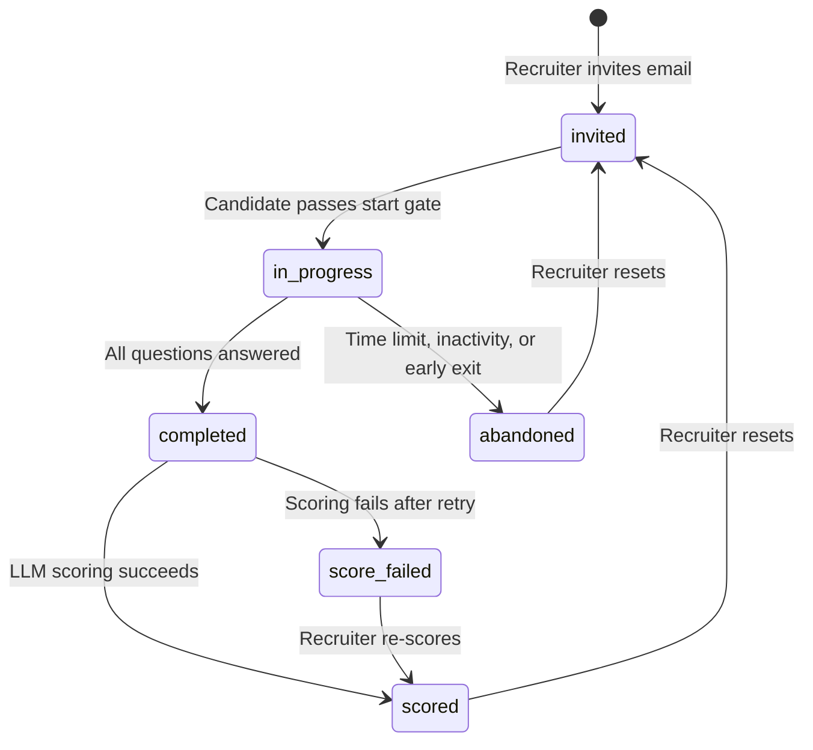

<div align="center">

# HireUp

**AI voice interviews, from invite to scorecard.**

Recruiters define the questions and rubrics. Candidates have a natural spoken conversation with an AI interviewer. HireUp transcribes it, scores it against your rubric, and hands you a structured recommendation.

[Live Demo](https://thehireup.vercel.app) · [Architecture](#architecture) · [Getting Started](#getting-started) · [API Reference](#api-reference) · [How It Works](docs/HOW_IT_WORKS.md)


</div>

---

## Table of Contents

- [Overview](#overview)
- [Features](#features)
- [Architecture](#architecture)
- [Interview Lifecycle](#interview-lifecycle)
- [Tech Stack](#tech-stack)
- [Project Structure](#project-structure)
- [Getting Started](#getting-started)
- [Configuration](#configuration)
- [API Reference](#api-reference)
- [Security Model](#security-model)
- [Testing](#testing)
- [Deployment](#deployment)
- [Known Limitations](#known-limitations)
- [Author](#author)

---

## Overview

Early-stage screening is repetitive, hard to schedule, and inconsistent between interviewers. HireUp replaces the first-round phone screen with an AI voice interviewer that asks every candidate the same questions, in the same order, at any time that suits them.

1. A **recruiter** creates a company, builds an interview (questions plus optional per-question rubrics), and invites candidates by email.
2. A **candidate** signs in with the invited email, joins a real-time voice room, and answers each question out loud.
3. HireUp **transcribes and scores** the conversation with an LLM and returns an overall score, a per-question breakdown, strengths, growth areas, and a hiring recommendation.

## Features

### For recruiters
- **Company workspace** with Clerk-backed authentication and ownership checks
- **Interview builder** with 1–10 questions, optional rubrics per question, a 5–60 minute time limit, and an expiry date
- **Bulk invites**: paste up to 50 emails at once; duplicates are skipped
- **Scorecards**: overall score (0–10), recommendation (`strong_yes` / `yes` / `maybe` / `no`), summary, strengths, growth areas, and per-question notes
- **Full transcripts** saved turn by turn as the conversation happens
- **Re-score** an attempt, **reset** it so the candidate can retry, or **delete** a mistaken invite

### For candidates
- **My Interviews** portal listing every interview assigned to your verified emails
- **Public landing info** (company, role, duration, expiry) before signing in
- **Natural voice conversation** with live audio visualisers and standard call controls
- Scores and internal notes are never exposed to candidates

### Platform
- **Low-latency voice pipeline**: Silero VAD, Groq Whisper (STT), Groq LLM, Deepgram Aura (TTS)
- **Atomic start gate** so an interview can't be started twice from two tabs
- **Prompt-injection hardening** in both the interviewer prompt and the scoring prompt
- **Schema-validated scoring** with Pydantic and one automatic retry

## Architecture

The system is split into a Next.js web app, a FastAPI service, and a standalone LiveKit voice agent worker. The agent connects to LiveKit Cloud directly and does not need to be co-located with the API.

```mermaid
%% Generated by https://gitdiagram.com/chinmaye5/hireup
flowchart TD

subgraph group_web["Web experience"]
  node_dashboard["Recruiter dashboard<br/>[page.tsx]"]
  node_interview_ui["Candidate interview<br/>[page.tsx]"]
  node_candidate_list["My interviews<br/>[page.tsx]"]
  node_attempt_detail["Attempt detail<br/>[page.tsx]"]
  node_interview_detail["Interview detail<br/>[page.tsx]"]
  node_api_client["API client<br/>[api.ts]"]
end

subgraph group_api["API and identity"]
  node_app["FastAPI application<br/>[main.py]"]
  node_auth["Authentication<br/>[auth_middleware.py]"]
  node_clerk["Clerk integration<br/>[clerk_service.py]"]
  node_user_data["User records<br/>[user_model.py]"]
end

subgraph group_recruiting["Recruiting workflow"]
  node_company_ops["Company management"]
  node_interview_ops["Interview templates and invites"]
  node_interview_data["Interview records<br/>[interview_model.py]"]
  node_attempt_ops["Attempt management"]
end

subgraph group_interview["Interview and evaluation"]
  node_attempt_data["Attempt records<br/>[attempt_model.py]"]
  node_candidate_ops["Candidate access and start gate"]
  node_livekit["LiveKit token service<br/>[livekit_service.py]"]
  node_agent["Voice interviewer agent<br/>[agent.py]"]
  node_prompt["Interviewer prompt"]
  node_scoring["Transcript scoring<br/>[scoring_service.py]"]
end

node_recruiter(("Recruiter"))
node_candidate(("Candidate"))
node_mongo[("MongoDB")]
node_groq["Groq LLM"]

node_app -->|"configures"| node_auth
node_app -->|"routes to"| node_company_ops
node_app -->|"routes to"| node_interview_ops
node_app -->|"routes to"| node_attempt_ops
node_app -->|"routes to"| node_candidate_ops
node_auth -->|"authenticates with"| node_clerk
node_auth -->|"upserts user"| node_user_data
node_interview_ops -->|"manages"| node_interview_data
node_interview_ops -->|"creates and queries"| node_attempt_data
node_attempt_ops -->|"manages"| node_attempt_data
node_attempt_ops -->|"requests rescoring"| node_scoring
node_candidate_ops -->|"checks and starts"| node_attempt_data
node_candidate_ops -->|"mints token"| node_livekit
node_agent -->|"updates attempt"| node_attempt_data
node_agent -->|"uses scoring"| node_scoring
node_agent -->|"uses prompt"| node_prompt
node_scoring -->|"loads and saves"| node_attempt_data
node_scoring -->|"requests evaluation"| node_groq
node_interview_ops -.->|"persists via models"| node_mongo
node_attempt_ops -.->|"persists via models"| node_mongo
node_company_ops -.->|"persists via models"| node_mongo

click node_dashboard "https://github.com/chinmaye5/hireup/blob/main/frontend/app/dashboard/page.tsx"
click node_interview_ui "https://github.com/chinmaye5/hireup/blob/main/frontend/app/interview/%5BattemptId%5D/page.tsx"
click node_candidate_list "https://github.com/chinmaye5/hireup/blob/main/frontend/app/my-interviews/page.tsx"
click node_attempt_detail "https://github.com/chinmaye5/hireup/blob/main/frontend/app/dashboard/attempts/%5Bid%5D/page.tsx"
click node_interview_detail "https://github.com/chinmaye5/hireup/blob/main/frontend/app/dashboard/interviews/%5Bid%5D/page.tsx"
click node_api_client "https://github.com/chinmaye5/hireup/blob/main/frontend/lib/api.ts"
click node_app "https://github.com/chinmaye5/hireup/blob/main/backend/main.py"
click node_auth "https://github.com/chinmaye5/hireup/blob/main/backend/middleware/auth_middleware.py"
click node_clerk "https://github.com/chinmaye5/hireup/blob/main/backend/services/clerk_service.py"
click node_user_data "https://github.com/chinmaye5/hireup/blob/main/backend/models/user_model.py"
click node_company_ops "https://github.com/chinmaye5/hireup/blob/main/backend/controllers/company_controller.py"
click node_interview_ops "https://github.com/chinmaye5/hireup/blob/main/backend/controllers/interview_controller.py"
click node_interview_data "https://github.com/chinmaye5/hireup/blob/main/backend/models/interview_model.py"
click node_attempt_ops "https://github.com/chinmaye5/hireup/blob/main/backend/controllers/attempt_controller.py"
click node_attempt_data "https://github.com/chinmaye5/hireup/blob/main/backend/models/attempt_model.py"
click node_candidate_ops "https://github.com/chinmaye5/hireup/blob/main/backend/controllers/candidate_controller.py"
click node_livekit "https://github.com/chinmaye5/hireup/blob/main/backend/services/livekit_service.py"
click node_agent "https://github.com/chinmaye5/hireup/blob/main/backend/agent.py"
click node_prompt "https://github.com/chinmaye5/hireup/blob/main/backend/utils/interviewer_prompt.py"
click node_scoring "https://github.com/chinmaye5/hireup/blob/main/backend/services/scoring_service.py"

classDef toneNeutral fill:#f8fafc,stroke:#334155,stroke-width:1.5px,color:#0f172a
classDef toneBlue fill:#dbeafe,stroke:#2563eb,stroke-width:1.5px,color:#172554
classDef toneAmber fill:#fef3c7,stroke:#d97706,stroke-width:1.5px,color:#78350f
classDef toneMint fill:#dcfce7,stroke:#16a34a,stroke-width:1.5px,color:#14532d
classDef toneRose fill:#ffe4e6,stroke:#e11d48,stroke-width:1.5px,color:#881337
classDef toneIndigo fill:#e0e7ff,stroke:#4f46e5,stroke-width:1.5px,color:#312e81
classDef toneTeal fill:#ccfbf1,stroke:#0f766e,stroke-width:1.5px,color:#134e4a
class node_dashboard,node_interview_ui,node_candidate_list,node_attempt_detail,node_interview_detail,node_api_client toneBlue
class node_app,node_auth,node_clerk,node_user_data,node_mongo toneAmber
class node_company_ops,node_interview_ops,node_interview_data,node_attempt_ops toneMint
class node_attempt_data,node_candidate_ops,node_livekit,node_agent,node_prompt,node_scoring toneRose
class node_recruiter,node_candidate,node_groq toneIndigo
```



The backend follows a layered, Express-style layout: **Routes → Auth middleware → Controllers → Models and Services**. Routes only declare endpoints; controllers hold business rules; models are plain async PyMongo functions; services wrap external APIs (Clerk, LiveKit, Groq).

## Interview Lifecycle



1. **Setup.** The recruiter signs in via Clerk, creates a company, builds an interview, and invites candidate emails. Each invite creates an *attempt* holding a snapshot of the questions, so later edits never change an in-flight interview.
2. **Start gate.** The candidate opens `/interview/<attempt_id>` and `POST /api/attempts/{id}/start` runs a single atomic `find_one_and_update`. It only succeeds if the attempt is `invited`, unexpired, and matches one of the candidate's **verified** Clerk emails. A LiveKit token is then minted, scoped to the room `attempt-<id>`.
3. **Voice loop.** The agent joins the room, greets the candidate, and asks Question 1. Each turn flows through VAD, STT, LLM, and TTS, and is appended to the attempt's transcript in MongoDB immediately.
4. **Completion and scoring.** After the final answer the agent says goodbye and shuts down. The attempt is marked `completed` and the scoring service evaluates the transcript against the questions and rubrics.
5. **Review.** The recruiter opens the attempt to see the score, recommendation, breakdown, and transcript.

For a deeper walkthrough, see [`docs/HOW_IT_WORKS.md`](docs/HOW_IT_WORKS.md).

## Tech Stack

| Layer | Technology |
| :--- | :--- |
| **Frontend** | Next.js 16 (App Router), React 19, TypeScript, Tailwind CSS 4, Framer Motion, Lucide |
| **Auth** | Clerk (`@clerk/nextjs` on the web, `clerk-backend-api` on the server) |
| **API** | FastAPI, Uvicorn, Pydantic v2 |
| **Database** | MongoDB Atlas via PyMongo's async client |
| **Realtime media** | LiveKit Cloud (WebRTC), `livekit-client`, `@livekit/components-react` |
| **Voice agent** | LiveKit Agents with Silero VAD, Groq Whisper Large v3 Turbo (STT), Groq `openai/gpt-oss-120b` (LLM), Deepgram Aura 2 (TTS) |
| **Scoring** | Groq LLM with JSON-mode output validated by Pydantic |
| **Tooling** | uv, Bun, pytest, ESLint, Docker, GitHub Actions |

## Project Structure

```
hireup/
├── backend/
│   ├── agent.py                  # LiveKit voice interviewer worker
│   ├── main.py                   # FastAPI entry point
│   ├── config/                   # Env loading and MongoDB setup/indexes
│   ├── routes/                   # Endpoint declarations (no business logic)
│   ├── controllers/              # Business rules and permissions
│   ├── models/                   # MongoDB access (users, companies, interviews, attempts)
│   ├── middleware/               # Clerk JWT verification, company membership checks
│   ├── services/                 # clerk, livekit, and scoring integrations
│   ├── schemas/                  # Pydantic request/response models
│   ├── utils/                    # Constants, helpers, serializers, interviewer prompt
│   ├── tests/                    # pytest suite
│   ├── Dockerfile                # Agent container image
│   ├── livekit.toml              # LiveKit Cloud agent config
│   └── .env.example
├── frontend/
│   ├── app/
│   │   ├── page.tsx              # Landing page
│   │   ├── dashboard/            # Recruiter dashboard, interviews, attempts
│   │   ├── my-interviews/        # Candidate portal
│   │   └── interview/[attemptId] # Live voice interview room
│   ├── components/               # Landing, dashboard, and UI components
│   ├── lib/api.ts                # Typed API client with Clerk bearer tokens
│   └── middleware.ts             # Route protection
├── docs/HOW_IT_WORKS.md
├── .github/workflows/deploy-livekit-agent.yml
└── requirements.txt
```

## Getting Started

### Prerequisites

- **Python 3.13+** and [uv](https://docs.astral.sh/uv/) (or `pip`)
- **Node.js 20+** and [Bun](https://bun.sh) (or npm/pnpm/yarn)
- A [MongoDB Atlas](https://www.mongodb.com/atlas) cluster
- A [Clerk](https://clerk.com) application
- A [LiveKit Cloud](https://cloud.livekit.io) project
- A [Groq](https://console.groq.com) API key
- A [Deepgram](https://console.deepgram.com) API key

### 1. Clone

```bash
git clone https://github.com/chinmaye5/hireup.git
cd hireup
```

### 2. Backend API

```bash
cd backend
cp .env.example .env        # then fill in your keys (see Configuration)

# with uv
uv sync
uv run uvicorn main:app --reload --port 8000

# or with pip
python -m venv .venv && source .venv/bin/activate
pip install -r requirements.txt
uvicorn main:app --reload --port 8000
```

The API is now at `http://localhost:8000`. Interactive docs are at `/docs`, and a health check is at `/health`.

### 3. Voice agent

In a second terminal, from `backend/`:

```bash
# with uv
uv run python agent.py dev

# or with pip (venv active)
python agent.py dev
```

`dev` mode connects to your LiveKit project and waits for rooms named `attempt-<id>`. Use `start` for production.

### 4. Frontend

```bash
cd frontend
cat > .env.local <<'EOF'
NEXT_PUBLIC_API_URL=http://localhost:8000
NEXT_PUBLIC_CLERK_PUBLISHABLE_KEY=pk_test_...
CLERK_SECRET_KEY=sk_test_...
EOF

bun install                        # or npm install
bun dev                            # or npm run dev
```

Open [http://localhost:3000](http://localhost:3000).

### 5. Try it

1. Sign in and create a company.
2. Create an interview with a few questions.
3. Invite an email address you can sign in with (a second account or an incognito window works well).
4. Open the invite link as the candidate and start the interview.

## Configuration

### Backend (`backend/.env`)

| Variable | Required | Description |
| :--- | :---: | :--- |
| `MONGODB_URI` | ✅ | MongoDB connection string |
| `MONGODB_DB_NAME` | | Database name (default `hireup`) |
| `CLERK_SECRET_KEY` | ✅ | Clerk backend secret key |
| `FRONTEND_ORIGINS` | | Comma-separated allowed CORS origins (default `http://localhost:3000`) |
| `LIVEKIT_URL` | ✅ | `wss://<your-project>.livekit.cloud` |
| `LIVEKIT_API_KEY` | ✅ | LiveKit API key |
| `LIVEKIT_API_SECRET` | ✅ | LiveKit API secret |
| `GROQ_API_KEY` | ✅ | Groq API key (STT, interviewer LLM, scoring) |
| `DEEPGRAM_API_KEY` | ✅ | Deepgram API key (TTS) |
| `INTERVIEWER_LLM_MODEL` | | Model for the live interviewer (default `openai/gpt-oss-120b`) |
| `SCORING_LLM_MODEL` | | Model for transcript scoring (default `openai/gpt-oss-120b`) |
| `AGENT_URL` | | Optional. If set, the API pings `<AGENT_URL>/health` every 4 minutes to keep a free-tier agent awake |

> The settings module validates required variables at import time, so the API **and** the agent both fail fast with a clear message if one is missing.

### Frontend (`frontend/.env.local`)

| Variable | Description |
| :--- | :--- |
| `NEXT_PUBLIC_API_URL` | Base URL of the FastAPI service (default `http://localhost:8000`) |
| `NEXT_PUBLIC_CLERK_PUBLISHABLE_KEY` | Clerk publishable key |
| `CLERK_SECRET_KEY` | Clerk secret key (used by Clerk middleware) |

## API Reference

All routes are mounted under `/api` and expect a Clerk session token as `Authorization: Bearer <token>` unless noted. The full OpenAPI spec is served at `/docs`.

### Identity

| Method | Path | Auth | Description |
| :--- | :--- | :--- | :--- |
| `GET` | `/health` | Public | Service health check |
| `GET` | `/api/me` | User | Current user profile and company |

### Recruiter

| Method | Path | Auth | Description |
| :--- | :--- | :--- | :--- |
| `POST` | `/api/companies` | User | Create a company |
| `POST` | `/api/interviews` | Company | Create an interview template |
| `GET` | `/api/interviews` | Company | List interviews with attempt counts |
| `GET` | `/api/interviews/{id}` | Company | Interview detail with attempt summaries |
| `POST` | `/api/interviews/{id}/invites` | Company | Invite candidate emails (duplicates skipped) |
| `DELETE` | `/api/interviews/{id}` | Company | Delete an interview and its attempts |
| `GET` | `/api/attempts` | Company | List all attempts for the company |
| `GET` | `/api/attempts/{id}` | Company | Attempt detail with transcript and result |
| `POST` | `/api/attempts/{id}/rescore` | Company | Re-run LLM scoring |
| `POST` | `/api/attempts/{id}/reset` | Company | Reset to `invited` so the candidate can retry |
| `DELETE` | `/api/attempts/{id}` | Company | Delete an invited attempt |

### Candidate

| Method | Path | Auth | Description |
| :--- | :--- | :--- | :--- |
| `GET` | `/api/my-attempts` | User | Interviews assigned to the user's verified emails (no scores or transcripts) |
| `GET` | `/api/attempts/{id}/public-info` | Public | Safe summary for the interview landing page |
| `POST` | `/api/attempts/{id}/start` | User | Start gate: returns `{ token, url, room_name }` |

**Start gate responses**

| Status | Meaning |
| :---: | :--- |
| `200` | Attempt started; LiveKit token returned |
| `404` | Not found, or the email does not match (deliberately indistinguishable) |
| `409` | Already started or finished |
| `410` | Interview link expired |

### Validation limits

| Field | Limit |
| :--- | :--- |
| Title | 3–120 characters |
| Questions per interview | 1–10 |
| Question text | up to 300 characters |
| Rubric | up to 500 characters |
| Time limit | 5–60 minutes |
| Invites per request | up to 50 emails |

## Security Model

- **Verified emails only.** Candidates are matched on their *verified* Clerk email addresses, not on whatever a client sends.
- **No information leaks.** A wrong-email start attempt returns the same `404` as a nonexistent attempt.
- **Atomic start.** One conditional `find_one_and_update` guarantees a single start, even across tabs. If token minting fails, the attempt is returned to `invited` so it isn't burned.
- **Scoped, short-lived tokens.** LiveKit tokens are limited to one room and expire at the time limit plus five minutes.
- **Authorized parties.** Clerk token verification checks the `azp` claim so tokens minted for other origins are rejected.
- **Company isolation.** Recruiter routes go through `require_company_user` and operate only on the caller's company.
- **Untrusted transcripts.** The scoring prompt wraps the transcript in tags and instructs the model to ignore any instructions inside it. The interviewer prompt does the same for candidate speech.
- **Candidate-safe views.** Candidates never receive transcripts, scores, or recruiter notes.

## Testing

```bash
cd backend
uv run pytest        # or: pytest
```

Current tests cover helper utilities (email normalisation, ObjectId parsing) and scoring-response parsing and validation (valid JSON, code-fenced JSON, malformed JSON, missing fields, out-of-range scores).

Frontend linting:

```bash
cd frontend
bun run lint
```

## Deployment

HireUp deploys as three independent pieces.

| Component | Suggested host | Notes |
| :--- | :--- | :--- |
| **Frontend** | Vercel | Set the three frontend env vars. |
| **API** | Render (Web Service) or any ASGI host | `uvicorn main:app --host 0.0.0.0 --port $PORT` with the backend env vars. Add your frontend URL to `FRONTEND_ORIGINS`. |
| **Voice agent** | LiveKit Cloud, or a container host | Built from `backend/Dockerfile`; runs `python agent.py start`. |

**Why the agent is separate.** Running the agent inside the API container exceeded the 512 MB free-tier memory limit and caused silent out-of-memory kills mid-interview. The agent is therefore its own deployable, tuned for low memory: thread-based job executor, no idle pre-warmed processes, single-threaded numeric libraries, and a small Mongo connection pool.

**CI/CD.** [`.github/workflows/deploy-livekit-agent.yml`](.github/workflows/deploy-livekit-agent.yml) deploys the agent to LiveKit Cloud on every push to `main` that touches `backend/`. Configure these repository secrets: `LIVEKIT_URL`, `LIVEKIT_API_KEY`, `LIVEKIT_API_SECRET`, `MONGODB_URI`, `MONGODB_DB_NAME`, `GROQ_API_KEY`, `DEEPGRAM_API_KEY`, `INTERVIEWER_LLM_MODEL`, and `SCORING_LLM_MODEL`.

**Docker (agent)**

```bash
cd backend
docker build -t hireup-agent .
docker run --env-file .env hireup-agent
```

## Known Limitations

- A candidate who refreshes the page mid-interview cannot rejoin the room. A recruiter must reset the attempt so they can try again.
- Interviews are English only (STT is pinned to `en`).
- Question completion is detected from the interviewer's closing phrases, so the farewell wording in the prompt and the detector in `agent.py` need to stay in sync.

## Author

**Chinmaye HG**
[GitHub](https://github.com/chinmaye5) · [Email](mailto:chinmaye115@gmail.com)

---

<div align="center">
Built with FastAPI, Next.js, LiveKit, Groq, and Deepgram.
</div>